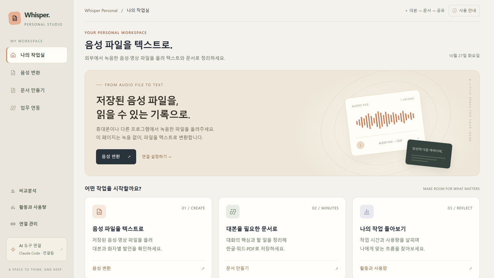

# Whisper Personal — 업무 자동화 웹 앱



녹음·영상·대본을 **받아쓰기 → 회의록(문서) → 업무 도구 공유**까지 한 흐름으로 처리하는 개인용 업무 자동화 워크스페이스입니다.

- **음성 → 텍스트**: 내 PC(또는 서버)에서 Whisper로 받아쓰고, 목소리로 화자를 구분합니다. AI 계정이나 사용량 제한 없이 동작합니다.
- **대본 → 문서**: Claude Code 또는 Codex(OpenAI)로 대본을 회의록 등 원하는 양식의 문서로 정리합니다. 한글(.hwpx)·워드(.docx)·PDF·마크다운으로 저장됩니다.
- **업무 연동**: 완성된 문서를 MCP 서비스 등에 게시·공유합니다(claude.ai 커넥터 / MCP 사용).

### 두 가지 방식으로 쓸 수 있습니다

| 방식 | 설명 |
|---|---|
| **Windows 개인용** | 내 PC에서 `run.bat`으로 실행해 혼자 씁니다. 파일은 탐색기에서 고르거나 끌어다 놓습니다. |
| **Linux 서버 다중 사용자** | 서버 한 대에 `run.sh`로 올려 두면 여러 사람이 각자의 브라우저로 접속해 같이 씁니다. 사람마다 자신의 Claude·Codex 로그인과 Jira·Confluence·Slack 연결을 따로 가지므로 계정을 공유할 필요가 없습니다. 단, 받아쓰기(화자 구분 포함)는 한 번에 한 명씩만 돌릴 수 있습니다. |

---

## 준비물

| 항목 | 필요한 경우 | 비고 |
|---|---|---|
| Python 3.11 | 항상 | `python --version`으로 확인 |
| NVIDIA GPU + 드라이버 | 선택 | 있으면 받아쓰기가 빨라집니다. 없으면 CPU로 동작합니다. |
| [Claude Code CLI](https://docs.claude.com/en/docs/claude-code) | 문서 만들기(Claude)·업무 연동 | 앱 화면의 **연결 관리**에서 로그인합니다. |
| [Codex CLI](https://github.com/openai/codex) | 문서 만들기(Codex) | 선택. 업무 연동은 현재 Claude Code만 지원합니다. |
| Confluence·Jira·Slack 계정 | 업무 연동 | claude.ai의 커넥터 설정에서 각자 연결합니다. |
| GitLab 액세스 토큰 | GitLab 연동 | 앱 화면에서 입력하면 OS 자격 증명 저장소(keyring)에 보관됩니다. |

받아쓰기 모델(Whisper)은 처음 사용할 때 Hugging Face에서 자동으로 내려받습니다(모델에 따라 수백 MB~3GB).
화자 구분 모델은 `models/` 폴더에 들어 있습니다.

---

## 설치와 실행

### Windows (혼자 쓰는 로컬)

`run.bat`을 더블클릭하세요. 처음 실행하면 가상환경(`.venv`)을 만들고 필요한 패키지를 설치한 뒤(몇 분 걸림) 서버를 띄웁니다.
GPU가 있으면 `requirements-gpu.txt`도 자동으로 설치합니다.

브라우저에서 **http://localhost:8788** 을 여세요.

직접 실행하려면:

```powershell
python -m venv .venv
.venv\Scripts\pip install -r requirements.txt
.venv\Scripts\pip install -r requirements-gpu.txt   # NVIDIA GPU가 있을 때만
$env:WEB_PORT = "8788"
.venv\Scripts\python server.py
```

> `server.py`를 직접 실행할 때 `WEB_PORT`를 지정하지 않으면 8787 포트를 씁니다.
> `run.bat`/`run.sh`는 원본 whisper-stt-web(8787)과 겹치지 않도록 8788을 기본값으로 씁니다.

### Linux (여럿이 쓰는 공유 서버)

```bash
./run.sh                                   # 127.0.0.1:8788
WEB_HOST=0.0.0.0 WEB_PORT=8788 ./run.sh    # 외부에서 접속 허용
```

`run.sh`도 처음 실행 시 `.venv`를 만들고 패키지를 설치합니다.
재부팅 후에도 계속 떠 있게 하려면 systemd `--user` 서비스로 등록하고(`systemctl --user enable --now <서비스 이름>`) `loginctl enable-linger`를 걸어 두세요.

서버 모드에서는 사용자마다 브라우저 쿠키(`wsid`)로 구분되어, 각자 자신의 Claude/GPT 로그인 연결을 따로 가집니다.
> **동시 사용 제한**: 받아쓰기(화자 구분 포함)는 서버 자원(특히 GPU)을 많이 쓰기 때문에 **한 번에 한 명만** 돌릴 수 있습니다. 다른 사람이 쓰는 중이면 "지금 다른 사람이 '받아쓰기' 작업을 하고 있어요" 안내가 나오고, 끝난 뒤에 다시 시도하면 됩니다.

---

## 사용법

### 1. 연결 관리 (처음 한 번)

1. 왼쪽 메뉴의 **연결 관리**를 엽니다.
2. **AI 도구**에서 Claude Code 또는 Codex를 고르고 로그인합니다.
   - **Claude**: 새 탭에서 로그인한 뒤, 받은 코드를 화면 입력칸에 붙여 넣습니다.
   - **Codex**: 화면에 나온 주소를 열고, 표시된 코드를 그 페이지에 직접 입력합니다(15분 유효). 완료되면 자동으로 연결됩니다.
3. 업무 연동을 쓰려면 claude.ai의 커넥터 설정에서 Confluence·Jira·Slack을 연결합니다. 연결 상태는 이 화면에서 확인할 수 있습니다.

### 2. 음성 변환 (음성·영상 → 대본)

1. **음성 변환**을 엽니다.
2. 녹음·영상 파일을 **찾아보기**로 고르거나, 탐색기에서 화면으로 **끌어다 놓습니다**.
   지원 형식: mp3 · wav · m4a · flac · ogg · aac · wma · mp4 · mkv · mov · avi · webm
3. 필요하면 **자세한 설정**을 펼쳐 옵션을 고릅니다.

   | 옵션 | 설명 |
   |---|---|
   | 언어 | 회의 언어를 지정하면 그 언어로만 받아 적어 더 정확해집니다. |
   | 품질 | 추천(large-v3-turbo) / 최고 품질(large-v3) / 보통 / 빠름 / 가장 빠름 |
   | 인원 | 참석 인원을 알면 숫자로 고르는 것이 화자 구분에 더 정확합니다. |
   | 화자 구분 | 목소리로 발언자를 나눠 "화자1: …", "화자2: …"로 기록합니다. |
   | 만들 것 | 대본만 만들지, 이어서 회의록까지 만들지 고릅니다. |

4. **음성 변환**(또는 **대본 및 회의록 만들기**)을 누릅니다.
5. 끝나면 저장 폴더에 화자별 대본(`.txt`)과 자막(`.srt`)이 생깁니다.
6. **화자 이름** 칸에 실제 이름을 적고 **적용하기**를 누르면, 대본 전체의 "화자1·화자2"가 그 이름으로 바뀝니다.

### 3. 문서 만들기 (대본 → 문서)

1. **문서 만들기**를 엽니다.
2. 대본 파일(`.txt`)을 고르거나 끌어다 놓습니다.
3. 아래 항목을 고릅니다.

   | 항목 | 설명 |
   |---|---|
   | 문서 종류 | 회의록 · 인터뷰 정리 · 강의 노트 · 업무 보고서 · 핵심 요약 · 자유 형식 |
   | AI 도구 | Claude Code 또는 Codex |
   | 만들 형식 | PDF · 한글(HWPX) · 워드(DOCX) · 마크다운 중 여러 개를 함께 고를 수 있습니다. |
   | 문서 양식 *(자세한 설정)* | 회사 양식이나 화면정의서 같은 템플릿(.hwpx · .docx · .pdf · .md · .txt)을 넣으면 그 구조에 맞춰 작성합니다. 비우면 기본 회의록 양식을 씁니다. |
   | 문서 제목 · 기준 일시 | 비우면 AI가 내용에 맞게 정하고, 일시는 오늘 날짜를 씁니다. |
   | Claude 모델 | 추천(기본값) / Opus / Sonnet / Haiku |
   | 추가 요청 | "할 일은 표로 정리해 주세요"처럼 작성 지침을 덧붙입니다. |
   | 참고 용어집 | "용어 = 바른 표기" 형식의 텍스트 파일(.txt · .md · .csv)을 넣으면, 자주 잘못 받아 적히는 전문용어·이름을 바로잡습니다. |

4. **문서 만들기**를 누르면 AI가 대본을 분석해 문서를 작성합니다. 잘못 받아 적힌 단어도 문맥에 맞게 바로잡습니다.
5. 끝나면 저장 폴더에 고른 형식의 파일이 함께 저장됩니다.

> 현재 실제로 만들 수 있는 문서 종류는 **회의록**입니다. 나머지 종류는 화면에서 고를 수 있지만 실행하면 "준비 중" 안내가 나옵니다(서버가 `init()` 응답의 `document_types`로 지원 종류를 알려 주면 그 종류부터 열립니다).
> 회의록 외의 형식이 필요하면 **문서 양식**에 원하는 템플릿을 넣으세요.

### 4. 업무 연동 (문서 → 공유)

1. **업무 연동**을 엽니다. 방금 만든 회의록이 자동으로 불러와집니다(다른 회의록 파일을 끌어다 놓아도 됩니다).
2. 공유할 도구를 켜고 대상을 지정합니다.
   - **Confluence**: 스페이스와 상위 페이지
   - **Slack**: 채널과 안내 문구
   - **Jira**: 프로젝트와 일감 유형
   - **GitLab**: 저장소와 라벨
3. **공유할 일감** 목록에서 올릴 항목을 고르고, 담당자·기한을 확인합니다.
4. **공유하기**를 누르면 선택한 도구에 게시됩니다. 결과는 완료 창에 요약됩니다.

### 그 밖의 화면

- **나의 작업실**: 전체 흐름 안내와 바로가기
- **비교분석**: 상용 전사 서비스와 직접 비교해 본 관찰 기록
- **활동과 사용량**: 작업별 소요 시간과 AI 토큰 사용량

---

## 폴더 구조

| 경로 | 설명 |
|---|---|
| `server.py` | HTTP 서버. 사용자별 `wsid` 쿠키 발급, 업로드·다운로드, 이벤트 전달 |
| `app.py` | 화면에서 부르는 API(받아쓰기·문서 만들기·공유 작업 관리) |
| `transcribe.py` | 받아쓰기(faster-whisper) |
| `diarize.py` · `speakers.py` | 화자 구분(sherpa-onnx)과 화자 이름 바꾸기 |
| `minutes.py` · `codex_cli.py` | Claude Code / Codex로 문서 정리, PDF·HWPX·DOCX·MD 저장 |
| `integrations.py` · `mcp_manager.py` · `gitlab_sync.py` | Confluence·Jira·Slack·GitLab 연동, MCP 커넥터 관리 |
| `ui/` | 화면(HTML·CSS·JS). 별도 빌드 과정 없음 |
| `models/` | 화자 구분 모델(ONNX) |
| `templates/` | 기본 회의록 양식 |
| `fonts/` | PDF용 한글 글꼴(나눔고딕) |
| `demo/` | 샘플 회의록 |
| `docs/` | UI ↔ 백엔드 연동 문서 |

다음 파일과 폴더는 개인 데이터라 저장소에 올라가지 않습니다(`.gitignore`):
`output/`(결과물), `uploads/`, `gui_settings.json`(설정), `stats.jsonl`(사용 기록), `.env`, `.claude/`

---

## 보안 주의사항

**Windows에서 혼자 쓰는 건 문제없습니다.** `run.bat`으로 실행하면 내 PC(`127.0.0.1`)에서만 접속할 수 있습니다.

아래 내용은 **Linux 서버 다중 사용자 모드**에서 해당합니다.

| 항목 | 판단 | 실제 상태 |
|---|---|---|
| `.env`, `.claude/` 제외 | 양호 | `.gitignore`로 저장소에 올라가지 않습니다. |
| `~/.claude-profiles/<uid>/` 경로 | 낮음 | 경로가 공개되는 것 자체는 문제가 아닙니다. 다만 각자의 Claude 로그인이 저장되는 곳이므로, 서버 계정만 읽을 수 있게 권한을 두세요. |
| `wsid` 쿠키 | 주의 | 값이 무작위라 추측할 수 없고 페이지 스크립트가 읽을 수 없습니다(HttpOnly). 하지만 이 쿠키 하나가 사용자 신원의 전부라, 누군가의 쿠키를 얻으면 그 사람의 Claude 로그인을 쓸 수 있습니다. 서버가 HTTPS가 아닌 일반 HTTP라 네트워크에서 쿠키가 노출될 수 있습니다. |
| 로그인 | **위험** | 로그인 기능이 없습니다. 서버에 접속할 수 있는 사람은 누구나 쓸 수 있습니다. |
| 결과물 | **위험** | 모든 사용자의 회의록이 `output/` 폴더 하나에 모이고, 누구나 목록을 보고 내려받을 수 있습니다. |
| 파일 경로 | **위험** | 브라우저가 부르는 기능들이 서버 파일 경로를 검사하지 않고 받습니다. 서버의 다른 텍스트 파일을 읽거나, 다른 폴더에 결과를 저장하거나, 다른 파일의 화자 이름을 바꿀 수 있습니다. |
| GitLab 토큰 | 주의 | 사람별이 아니라 저장소 주소별로 저장되어, 같은 서버의 다른 사람이 누군가 저장한 토큰을 쓸 수 있습니다. 데스크톱이 없는 Linux 서버에서는 토큰 저장이 실패할 수도 있습니다. |
| `WEB_HOST=0.0.0.0` | **위험** | 인증과 HTTPS 없이 인터넷에 열면 누구나 서버와 AI 계정을 쓸 수 있습니다. |

**서버 모드를 안전하게 쓰는 방법**

- 사내망이나 VPN 안에서, 믿을 수 있는 동료끼리만 쓰세요.
- 인터넷에 열지 마세요. 꼭 열어야 한다면 nginx 같은 리버스 프록시 뒤에 두고 로그인과 HTTPS를 붙이세요.

---

## 라이선스

이 프로젝트의 코드는 [Unlicense](LICENSE)(퍼블릭 도메인)입니다. 출처 표시 없이 누구나 자유롭게 가져다 쓰고, 고치고, 재배포해도 됩니다. Windows에서 개인적으로 써도 되고, Linux 서버에 올려 여러 사람이 같이 써도 됩니다.

함께 들어 있거나 설치·실행 중 내려받는 것들은 각자의 라이선스를 따릅니다.

- **화자 구분 모델** (`models/`): pyannote segmentation-3.0 (MIT), 3D-Speaker ERes2Net (Apache-2.0)
- **받아쓰기 모델** (실행 중 내려받음): OpenAI Whisper (MIT)
- **글꼴** (`fonts/`): 나눔고딕 (SIL Open Font License 1.1, `fonts/OFL.txt`)
- **Python 패키지** (`requirements.txt`): 대부분 MIT · BSD · Apache-2.0 (edge-tts만 LGPL-3.0). GPU 패키지는 NVIDIA 라이선스.
- **외부 도구** (Claude Code, Codex, Confluence · Jira · Slack · GitLab): 코드에 포함되지 않으며, 사용할 때 각 서비스 약관을 따릅니다.

비교분석 화면의 클로바노트™는 NAVER㈜의 상표이며, 이 앱은 해당 서비스와 제휴 관계가 없습니다.
